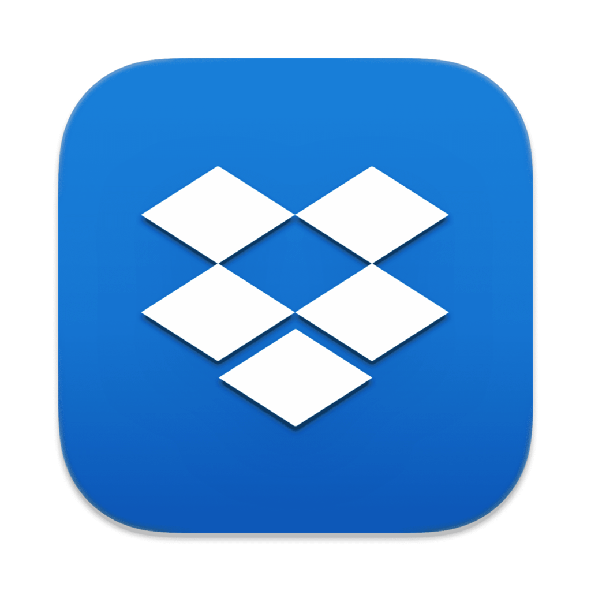
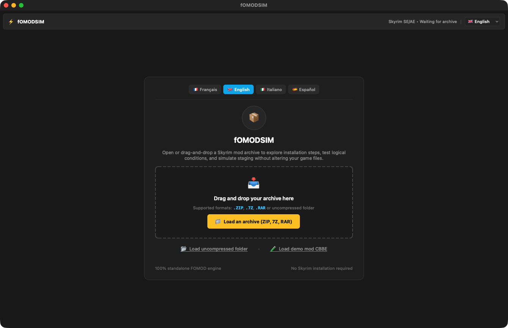
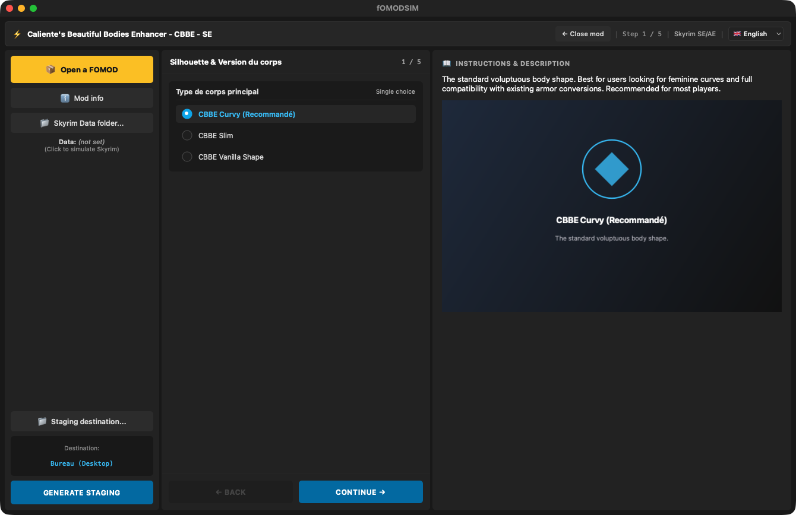

<p align="center"></p>

# fOMODSIM

**FOMOD installer simulator: walk through a mod's installer and preview the result, no mod manager needed.**  
*Simulateur d'installateurs FOMOD : parcourez l'installateur d'un mod et prévisualisez le résultat, sans gestionnaire de mods.*

🇬🇧 [English](#-english) · 🇫🇷 [Français](#-français)

---
## 🇬🇧 English

### What it does

FOMOD installers normally only run inside Mod Organizer 2 or Vortex, which are hard to use on a Mac. fOMODSIM opens a mod archive, lets you go through its installation steps, evaluates its conditions and flags, and copies the resulting files to a staging folder.

Detailed guide: [docs/README.en.md](docs/README.en.md)

### Features

- Opens **.zip, .7z, .rar** archives or an unpacked folder (drag and drop supported).
- Step-by-step navigation, single and multiple choices, recommended options pre-selected.
- Evaluation of FOMOD **conditions and flags**, required files and conditional installs.
- Description and image preview for every option.
- **Staging** generation: the files resulting from your choices are copied to a folder of your choice.
- Optional simulated Skyrim **Data** folder to test file-dependent conditions.
- Built-in **CBBE demo mod** to try the app without any archive.
- Interface in **English, French, Italian and Spanish** (follows your Mac's language; can be changed in the app).

### Screenshots


*Welcome screen*


*Installer step with option preview*

### Requirements

A Mac with **Apple Silicon** (M1 or later), **macOS 13 Ventura** or later. No Python, no Wine, no virtual machine needed.

### Installation

1. Download the zip from Nexus Mods (or from the GitHub releases) and unzip it.
2. Move **fOMODSIM.app** to your **Applications** folder.
3. First launch: the app is signed with a personal certificate but **not notarized by Apple**, so macOS blocks it. Open **System Settings → Privacy & Security**, scroll down and click **Open Anyway** next to fOMODSIM, then confirm. On macOS 14 or earlier you can also right-click the app → **Open** → **Open**.
4. Still blocked? In Terminal: `xattr -dr com.apple.quarantine /Applications/fOMODSIM.app`

### How to use

1. Drop a mod archive on the window, or click **Load an archive** (or **Load demo mod CBBE** to try).
2. Click an option to see its description and image; use **Continue** / **Back** between steps.
3. Choose the **Staging destination…** (Desktop by default) and, optionally, a **Skyrim Data folder…**.
4. Click **GENERATE STAGING**: the selected files are copied, ready to be added to your game or a modlist.

### FAQ

**A .rar archive won't open.**  
Install p7zip or unrar (for example `brew install p7zip`).

**The archive has no installer.**  
The mod has no FOMOD wizard: copy its files directly.

### Building from source

Requires Python 3.12 with PyQt6 and PyInstaller. From the repository folder:

```bash
./build_app.sh
```

→ [docs/DEVELOPMENT.md](docs/DEVELOPMENT.md)

### License

Released under the **MIT License**: free to use, modify and share. Part of the **Skyrim Mac Toolkit**, a set of modding tools built for Skyrim players on Mac.

---

## 🇫🇷 Français

### À quoi ça sert

Les installateurs FOMOD ne tournent normalement que dans Mod Organizer 2 ou Vortex, difficiles à utiliser sur Mac. fOMODSIM ouvre une archive de mod, vous fait parcourir ses étapes d'installation, évalue ses conditions et ses flags, et copie les fichiers obtenus dans un dossier de staging.

Guide détaillé : [docs/README.fr.md](docs/README.fr.md)

### Fonctions

- Ouvre les archives **.zip, .7z, .rar** ou un dossier décompressé (glisser-déposer accepté).
- Navigation étape par étape, choix uniques et multiples, options recommandées présélectionnées.
- Évaluation des **conditions et flags** FOMOD, des fichiers requis et des installations conditionnelles.
- Description et image de chaque option.
- Génération d'un **staging** : les fichiers issus de vos choix sont copiés dans le dossier de votre choix.
- Dossier **Data** de Skyrim simulé (facultatif) pour tester les conditions qui dépendent des fichiers.
- **Mod de démo CBBE** intégré pour essayer l'appli sans archive.
- Interface en **français, anglais, italien et espagnol** (suit la langue du Mac ; modifiable dans l'appli).

### Captures d'écran


*Écran d'accueil*


*Étape d'installation avec aperçu de l'option*

### Configuration requise

Un Mac **Apple Silicon** (M1 ou plus récent), **macOS 13 Ventura** ou plus récent. Ni Python, ni Wine, ni machine virtuelle.

### Installation

1. Téléchargez le zip sur Nexus Mods (ou dans les releases GitHub) et décompressez-le.
2. Placez **fOMODSIM.app** dans votre dossier **Applications**.
3. Premier lancement : l'appli est signée avec un certificat personnel mais **pas notarisée par Apple**, macOS la bloque donc. Ouvrez **Réglages Système → Confidentialité et sécurité**, descendez et cliquez sur **Ouvrir quand même** à côté de fOMODSIM, puis confirmez. Sous macOS 14 ou antérieur, vous pouvez aussi faire clic droit sur l'appli → **Ouvrir** → **Ouvrir**.
4. Toujours bloquée ? Dans le Terminal : `xattr -dr com.apple.quarantine /Applications/fOMODSIM.app`

### Utilisation

1. Déposez une archive de mod sur la fenêtre, ou cliquez sur **Charger une archive** (ou **Charger le mod démo CBBE** pour essayer).
2. Cliquez sur une option pour voir sa description et son image ; passez d'une étape à l'autre avec **Continuer** / **Retour**.
3. Choisissez la **Destination du Staging…** (Bureau par défaut) et, si besoin, un **Dossier Data de Skyrim…**.
4. Cliquez sur **GÉNÉRER LE STAGING** : les fichiers choisis sont copiés, prêts à être ajoutés au jeu ou à une modlist.

### Questions fréquentes

**Une archive .rar ne s'ouvre pas.**  
Installez p7zip ou unrar (par exemple `brew install p7zip`).

**L'archive n'a pas d'installateur.**  
Le mod n'a pas d'assistant FOMOD : copiez directement ses fichiers.

### Compiler depuis les sources

Nécessite Python 3.12 avec PyQt6 et PyInstaller. Depuis le dossier du dépôt :

```bash
./build_app.sh
```

→ [docs/DEVELOPMENT.md](docs/DEVELOPMENT.md)

### Licence

Publié sous **licence MIT** : libre d'utilisation, de modification et de partage. Fait partie du **Skyrim Mac Toolkit**, un ensemble d'outils de modding pensés pour les joueurs de Skyrim sur Mac.
