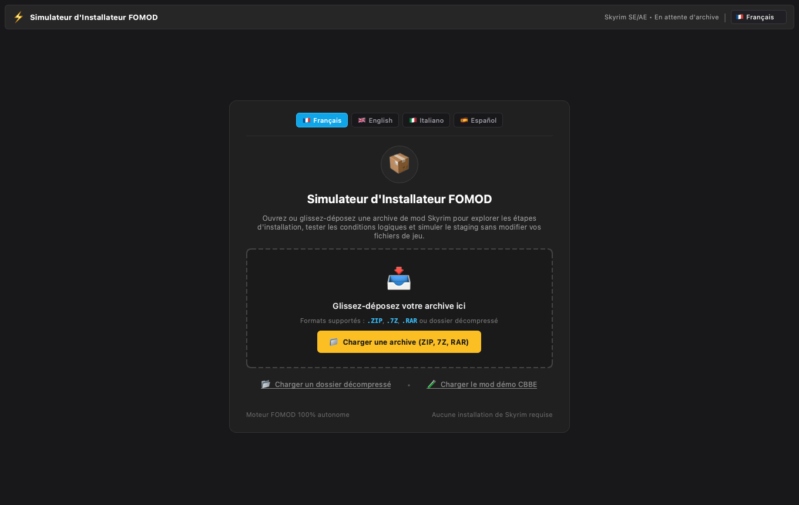
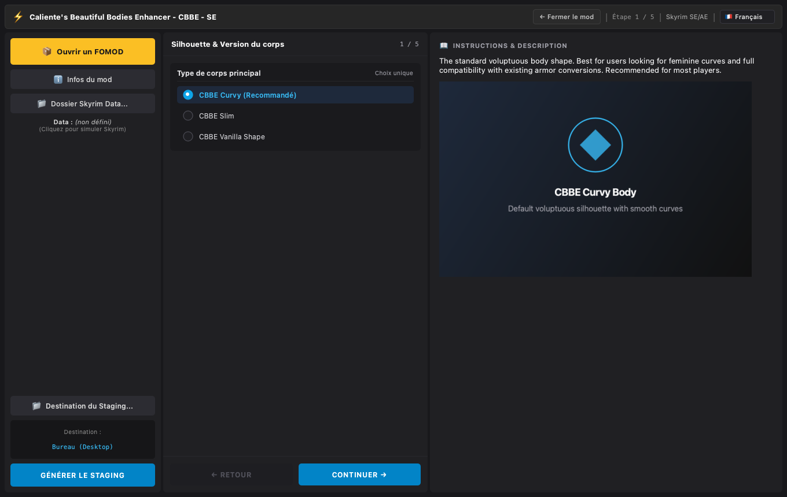
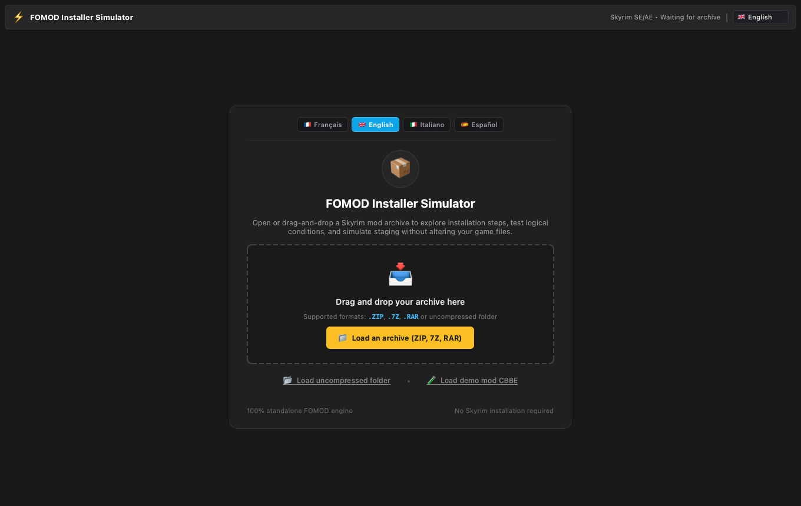
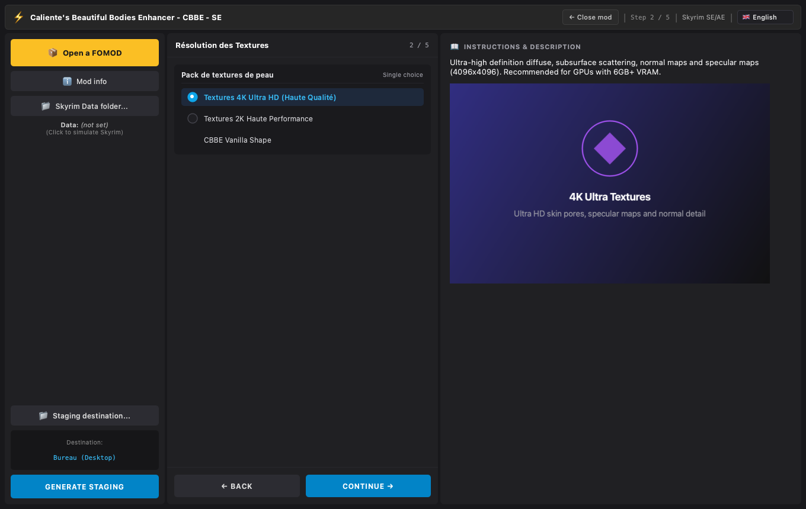

# Fiche Nexus Mods / Nexus Mods Page

🇫🇷 [Français](#-français) · 🇬🇧 [English](#-english)

> Les images référencées sont dans `docs/images/`. Sur Nexus, téléversez-les dans la galerie et remplacez les liens relatifs par les URLs hébergées. / Images live in `docs/images/`; upload them to the Nexus gallery and replace relative links with hosted URLs.

---

## 🇫🇷 Français

### Titre
**fOMODSIM — Prévisualisez et préparez vos installeurs FOMOD (macOS / Linux / Windows)**

### Résumé court (≈ 350 caractères max)
Ouvrez n'importe quel mod Skyrim avec un installeur FOMOD, parcourez ses étapes, testez les conditions, puis générez le résultat dans un dossier — sans installer Skyrim ni gestionnaire de mods. Interface en français, anglais, italien et espagnol.

### Description

# 📦 fOMODSIM

**fOMODSIM** est une application de bureau qui exécute l'installeur FOMOD d'un mod Skyrim **sans toucher à votre jeu**. Vous choisissez vos options, vous voyez exactement ce qui sera installé, puis vous exportez les fichiers dans un dossier de « staging ».

Pensé pour les joueurs sous **macOS et Linux**, où Mod Organizer 2 et Vortex ne sont pas disponibles, mais utile aussi sous Windows pour **inspecter un FOMOD avant de l'installer**.

## ✨ Fonctionnalités

- Ouvre les `.zip`, `.7z`, `.rar` et les **dossiers décompressés** (glisser-déposer).
- Navigation étape par étape, choix uniques ou multiples, options recommandées présélectionnées.
- Gestion des **conditions, drapeaux (flags), fichiers requis et installations conditionnelles**.
- Description et images de chaque option.
- **Génération du staging** vers le dossier de votre choix.
- Informations du mod (nom, auteur, version).
- Interface **FR / EN / IT / ES**, changement de langue à la volée.
- Mod de démonstration intégré pour tester immédiatement.
- Thème sombre, application légère et autonome.

## 🖼️ Captures

## 🚀 Mode d'emploi

1. Lancez **fOMODSIM** et choisissez votre langue.
2. Glissez-déposez l'archive du mod (ou **Charger un dossier décompressé**).
3. Parcourez les étapes avec **Continuer / Retour** ; cliquez sur une option pour voir sa description.
4. Cliquez sur **Destination du Staging…** puis **GÉNÉRER LE STAGING**.
5. Copiez ensuite le contenu du staging dans votre dossier `Data` (ou importez-le dans votre gestionnaire).

## 📋 Prérequis

| Version | Prérequis |
|---|---|
| macOS | Apple Silicon (arm64), aucun Python requis |
| Windows / Linux / macOS (Python) | Python ≥ 3.9, `PyQt6`, `py7zr` |
| Fichiers `.rar` | `7-Zip`/`p7zip`, `unrar` ou `bsdtar` |

Skyrim **n'a pas besoin** d'être installé.

## ⬇️ Installation

- **macOS** : décompressez, glissez `fOMODSIM.app` dans `/Applications`. Application signée avec un certificat personnel, non notariée : au premier lancement, **clic droit → Ouvrir**.
- **Python** : `pip install PyQt6 py7zr` puis `python3 -m python_app.main`.

## ⚠️ À savoir

- L'outil **ne modifie pas** votre installation Skyrim : il produit uniquement un dossier de staging.
- Version Linux : portage documenté, **non testé**.
- Application non notariée Apple.

## 🛠️ Compatibilité & Langues

Skyrim SE / AE / LE (installeurs FOMOD standards) · Français, English, Italiano, Español.

## 📜 Crédits & Licence

Développé par Skyrim Tools. Mod de démonstration fictif basé sur la structure d'un installeur CBBE. Merci à la communauté de modding Skyrim.

### Tags suggérés
`Utilities`, `FOMOD`, `macOS`, `Linux`, `Mod installer`, `Tools`

### Journal des modifications (Changelog)
**v1.0.0** — Version initiale : lecture FOMOD, staging, 4 langues, application macOS signée.

---

## 🇬🇧 English

### Title
**fOMODSIM — Preview and prepare FOMOD installers (macOS / Linux / Windows)**

### Short summary (≈ 350 chars max)
Open any Skyrim mod with a FOMOD installer, walk through its steps, test its conditions, then export the result to a folder — no Skyrim install or mod manager needed. UI in English, French, Italian and Spanish.

### Description

# 📦 fOMODSIM

**fOMODSIM** is a desktop app that runs a Skyrim mod's FOMOD installer **without touching your game**. Pick your options, see exactly what would be installed, then export the files to a "staging" folder.

Built for **macOS and Linux** players, where Mod Organizer 2 and Vortex are unavailable, and also handy on Windows to **inspect a FOMOD before installing it**.

## ✨ Features

- Opens `.zip`, `.7z`, `.rar` and **unpacked folders** (drag & drop).
- Step-by-step navigation, single/multiple choice, recommended options pre-selected.
- Handles **conditions, flags, required files and conditional installs**.
- Description and image for every option.
- **Staging generation** to the folder of your choice.
- Mod information (name, author, version).
- **EN / FR / IT / ES** UI, on-the-fly language switch.
- Built-in demo mod to try it instantly.
- Dark theme, lightweight standalone app.

## 🖼️ Screenshots

## 🚀 How to use

1. Launch **fOMODSIM** and pick your language.
2. Drag & drop the mod archive (or **Load an unpacked folder**).
3. Move through steps with **Continue / Back**; click an option to read its description.
4. Click **Staging destination…** then **GENERATE STAGING**.
5. Copy the staging content into your `Data` folder (or import it into your mod manager).

## 📋 Requirements

| Edition | Requirements |
|---|---|
| macOS | Apple Silicon (arm64), no Python required |
| Windows / Linux / macOS (Python) | Python ≥ 3.9, `PyQt6`, `py7zr` |
| `.rar` files | `7-Zip`/`p7zip`, `unrar` or `bsdtar` |

Skyrim does **not** need to be installed.

## ⬇️ Installation

- **macOS**: unzip, drag `fOMODSIM.app` into `/Applications`. App signed with a personal certificate, not notarized: on first launch, **right-click → Open**.
- **Python**: `pip install PyQt6 py7zr` then `python3 -m python_app.main`.

## ⚠️ Good to know

- The tool **does not modify** your Skyrim install: it only produces a staging folder.
- Linux edition: port documented, **untested**.
- App is not Apple-notarized.

## 🛠️ Compatibility & Languages

Skyrim SE / AE / LE (standard FOMOD installers) · English, Français, Italiano, Español.

## 📜 Credits & License

Developed by Skyrim Tools. Fictional demo mod modeled on a CBBE installer structure. Thanks to the Skyrim modding community.

### Suggested tags
`Utilities`, `FOMOD`, `macOS`, `Linux`, `Mod installer`, `Tools`

### Changelog
**v1.0.0** — Initial release: FOMOD reading, staging, 4 languages, signed macOS app.
